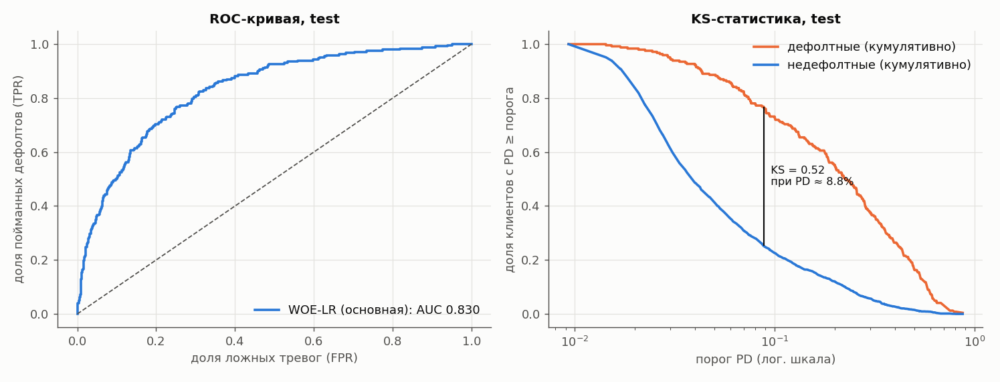
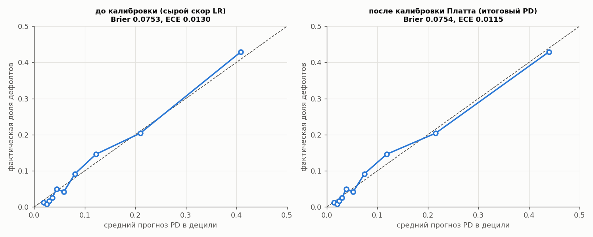
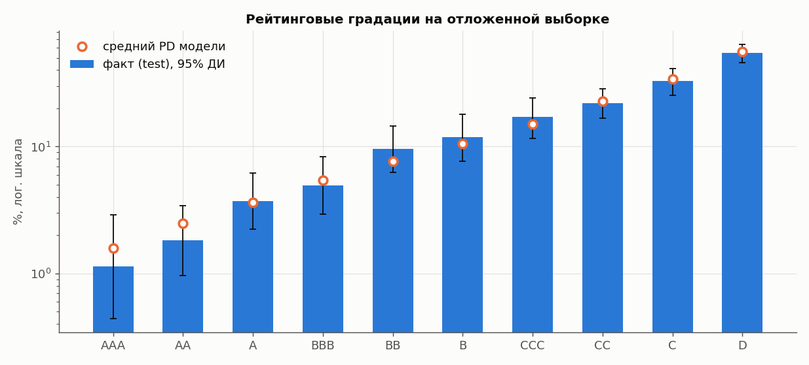
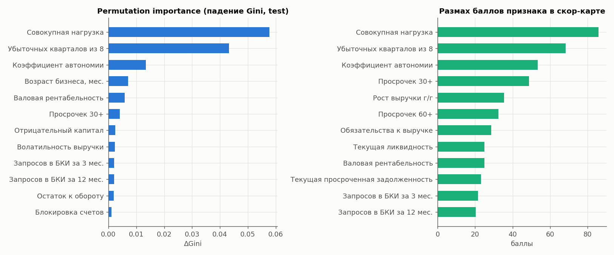

# Отчёт о модели оценки кредитного риска

> ⚠️ **Модель обучена на синтетических данных.** Метрики характеризуют качество методологии на искусственной выборке и **не переносятся на реальный портфель**. Это демонстрация подхода, а не боевая модель.

Модель: `v1.0.0-woe-logit` (основная, WOE-логистическая регрессия + калибровка Платта + скор-карта). Датасет `synth-v1.0` (seed 42). Воспроизведение: `make train && make report`; графики — `docs/ml/img/`.

## 1. Выборки и протокол
Одна компания = одна заявка, разбиение стратифицировано **по компаниям** (повторных наблюдений нет): train 7200 / valid 2400 / test 2400; доля дефолтов 10.24% / 10.25% / 10.25%. Train — обучение и WOE-биннинг; valid — подбор гиперпараметров, калибровка; границы рейтингов подбирались на train+valid; **test использован один раз для итоговой оценки**. Утечки исключены: цель и производные (`oracle_pd`) не входят в признаки (проверено кодом); максимальный одномерный Gini отдельного признака ниже 0.7 (проверка в ноутбуке 02), «подозрительно сильных» признаков нет.

## 2. Различающая способность и точность (ТЗ 2.4.1–2.4.3)
| Модель | Выборка | n | Доля дефолтов | AUC | Gini | KS | Brier | ECE |
|---|---|---|---|---|---|---|---|---|
| WOE-LR (основная) | train | 7200 | 10.24% | 0.825 | 0.649 | 0.515 | 0.0738 | 0.0091 |
| WOE-LR (основная) | valid | 2400 | 10.25% | 0.825 | 0.651 | 0.546 | 0.0747 | 0.0091 |
| **WOE-LR (основная)** | **test** | 2400 | 10.25% | 0.830 | 0.659 | 0.517 | 0.0754 | 0.0115 |

**Основная модель на test (95% бутстрэп-ДИ):** Gini **0.659** [0.605; 0.711], KS **0.517** [0.479; 0.577], Brier **0.0754** [0.0677; 0.0832], ROC-AUC 0.830. Требование ТЗ Gini ≥ 0.45 **выполнено** (нижняя граница ДИ 0.605 тоже выше порога). Brier Skill Score относительно «всем средний PD» = 0.181. Разрыв Gini train→test -0.010 (переобучения не видно).

## 3. Калибровка (ТЗ 2.3.4, 2.4.3)
Метод выбран кросс-валидацией внутри valid: Platt (параметры a=1.107, b=0.174); isotonic не дал выигрыша в Brier > 2%. Средний PD на test 10.27% при факте 10.25%; ECE 0.0115.

| Дециль | Средний прогноз PD | Факт |
|---|---|---|
| 1 | 1.46% | 1.25% |
| 2 | 2.01% | 0.83% |
| 3 | 2.48% | 1.67% |
| 4 | 3.0% | 2.5% |
| 5 | 3.82% | 5.0% |
| 6 | 5.2% | 4.17% |
| 7 | 7.43% | 9.17% |
| 8 | 11.83% | 14.58% |
| 9 | 21.54% | 20.42% |
| 10 | 43.95% | 42.92% |

## 4. Таблица рейтингов на отложенной выборке (ТЗ 2.4.5)
Фактическая доля дефолтов **монотонно растёт** от AAA к D: на test — True, на всей выборке из 12 000 заявок — True. Средний PD модели попадает в 95% доверительный интервал (Уилсон) факта во всех градациях (в верхних рейтингах — единицы дефолтов, интервалы широки).

| Рейтинг | Заявок | Доля | Дефолтов | Средний PD | Факт. доля дефолтов | 95% ДИ факта |
|---|---|---|---|---|---|---|
| AAA | 352 | 14.7% | 4 | 1.59% | 1.14% | 0.4–2.9% |
| AA | 493 | 20.5% | 9 | 2.48% | 1.83% | 1.0–3.4% |
| A | 375 | 15.6% | 14 | 3.64% | 3.73% | 2.2–6.2% |
| BBB | 262 | 10.9% | 13 | 5.44% | 4.96% | 2.9–8.3% |
| BB | 198 | 8.2% | 19 | 7.67% | 9.6% | 6.2–14.5% |
| B | 151 | 6.3% | 18 | 10.56% | 11.92% | 7.7–18.1% |
| CCC | 135 | 5.6% | 23 | 14.97% | 17.04% | 11.6–24.3% |
| CC | 195 | 8.1% | 43 | 22.67% | 22.05% | 16.8–28.4% |
| C | 128 | 5.3% | 42 | 33.9% | 32.81% | 25.3–41.3% |
| D | 111 | 4.6% | 61 | 55.68% | 54.95% | 45.7–63.9% |

## 5. Стабильность (ТЗ 2.4.4)
- **PSI скора:** train→test **0.0066**, train→valid 0.0012; по годам заявок 2023/2024/2025: 0.0015 / 0.0029 / 0.0028 (порог «стабильно» < 0.10).
- **PSI признаков** train→test: максимум 0.0110, признаков с PSI > 0.1: 0.
- **Сегменты (test, valid+test для годов).** Gini по сегментам (n ≥ 150 и ≥ 10 дефолтов): от 0.53 до 0.76, сегментов с Gini ≥ 0.45: 21 из 21. Различия частично объясняются малым размером сегментов (шум).

| Сегмент | Значение | n | Доля дефолтов | Средний PD | Gini |
|---|---|---|---|---|---|
| отрасль | agriculture | 124 | 9.7% | 6.9% | — |
| отрасль | catering | 228 | 14.0% | 12.9% | 0.64 |
| отрасль | construction | 262 | 13.0% | 12.2% | 0.54 |
| отрасль | health_edu | 133 | 6.8% | 6.6% | — |
| отрасль | it_services | 226 | 4.9% | 4.1% | 0.76 |
| отрасль | manufacturing | 265 | 4.9% | 6.6% | 0.54 |
| отрасль | personal_serv | 206 | 5.3% | 6.2% | 0.76 |
| отрасль | real_estate | 68 | 1.5% | 2.8% | — |
| отрасль | retail_food | 379 | 17.2% | 16.8% | 0.59 |
| отрасль | transport | 210 | 2.9% | 6.0% | — |
| отрасль | wholesale | 299 | 17.4% | 16.8% | 0.53 |
| форма | IP | 865 | 11.0% | 10.9% | 0.69 |
| форма | OOO | 1535 | 9.8% | 9.9% | 0.64 |
| размер | малый (>15 чел.) | 305 | 11.1% | 9.5% | 0.64 |
| размер | микро (≤15 чел.) | 2095 | 10.1% | 10.4% | 0.66 |
| продукт | EXPRESS | 464 | 10.1% | 10.0% | 0.61 |
| продукт | INVESTMENT | 631 | 10.0% | 10.8% | 0.65 |
| продукт | OVERDRAFT | 472 | 10.4% | 10.3% | 0.74 |
| продукт | WORKING_CAPITAL | 833 | 10.4% | 10.0% | 0.65 |
| уровень региона | 1 | 784 | 11.5% | 10.3% | 0.63 |
| уровень региона | 2 | 1074 | 8.8% | 9.9% | 0.73 |
| уровень региона | 3 | 542 | 11.3% | 11.1% | 0.59 |
| год заявки (valid+test) | 2023 | 1720 | 9.7% | 10.5% | 0.66 |
| год заявки (valid+test) | 2024 | 1738 | 10.1% | 10.2% | 0.66 |
| год заявки (valid+test) | 2025 | 1342 | 11.3% | 9.9% | 0.65 |

## 6. Какие факторы влияют на PD и как это проверено
**Скор-карта** содержит 25 признаков. Самые «тяжёлые» по размаху баллов: совокупная нагрузка, убыточных кварталов из 8, коэффициент автономии, просрочек 30+, рост выручки г/г, просрочек 60+. По падению Gini при перемешивании на test (permutation importance) лидируют: совокупная нагрузка, убыточных кварталов из 8, коэффициент автономии, возраст бизнеса, мес., валовая рентабельность, просрочек 30+.

| Признак | Падение Gini при перемешивании |
|---|---|
| Совокупная нагрузка | 0.0578 |
| Убыточных кварталов из 8 | 0.0433 |
| Коэффициент автономии | 0.0134 |
| Возраст бизнеса, мес. | 0.0071 |
| Валовая рентабельность | 0.0058 |
| Просрочек 30+ | 0.0041 |
| Отрицательный капитал | 0.0024 |
| Волатильность выручки | 0.0024 |
| Запросов в БКИ за 3 мес. | 0.0020 |
| Запросов в БКИ за 12 мес. | 0.0020 |
| Остаток к обороту | 0.0018 |
| Блокировка счетов | 0.0011 |

Для объяснения клиенту используются баллы скор-карты (вклад каждого признака), а не рейтинг важности.

**Проверка здравого смысла** (ухудшаем один фактор у реальных заявок test, смотрим средний PD) — все знаки верные, PD реагирует и на сумму, и на срок заявки:

| Стресс-изменение | Δ среднего PD |
|---|---|
| сумма заявки ×2 | +0.0076 |
| срок короче вдвое (платёж выше) | +0.0066 |
| выручка последнего кв. −30% | +0.0131 |
| просрочка 90+ (150 дн.) | +0.0805 |
| налоговый долг = 1 мес. выручки | +0.0011 |
| блокировка счёта | +0.0049 |
| +3 запроса в БКИ за 3 мес. | +0.0129 |

Дополнительно автотесты (`pytest`, 27 шт.) проверяют, что рост суммы заявки, текущих платежей, просрочек и блокировка счёта **не снижают PD**, а вывод детерминирован.

## 7. Ограничения и честные оговорки (ТЗ 2.4.8)
1. Данные синтетические, а закономерности заданы нашей порождающей моделью, — высокое качество частично «подсказано» структурой данных. Метрики **не переносятся** на реальность.
2. Редкие события (блокировка счёта, банкротство) представлены десятками наблюдений; их веса в модели оценены неточно.
3. Верхние рейтинги (AAA/AA) содержат единицы дефолтов — различие между соседними градациями статистически слабое (см. доверительные интервалы).
4. Скор отражает риск дефолта за 12 мес.; он не учитывает макроэкономику, залоги и поведение после выдачи.
